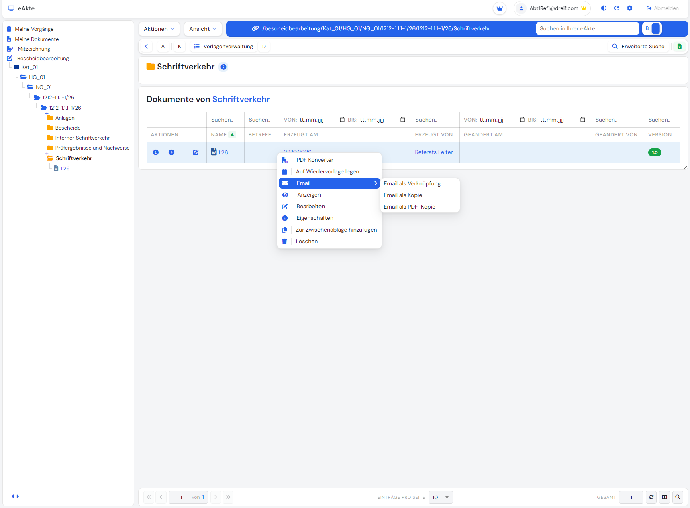
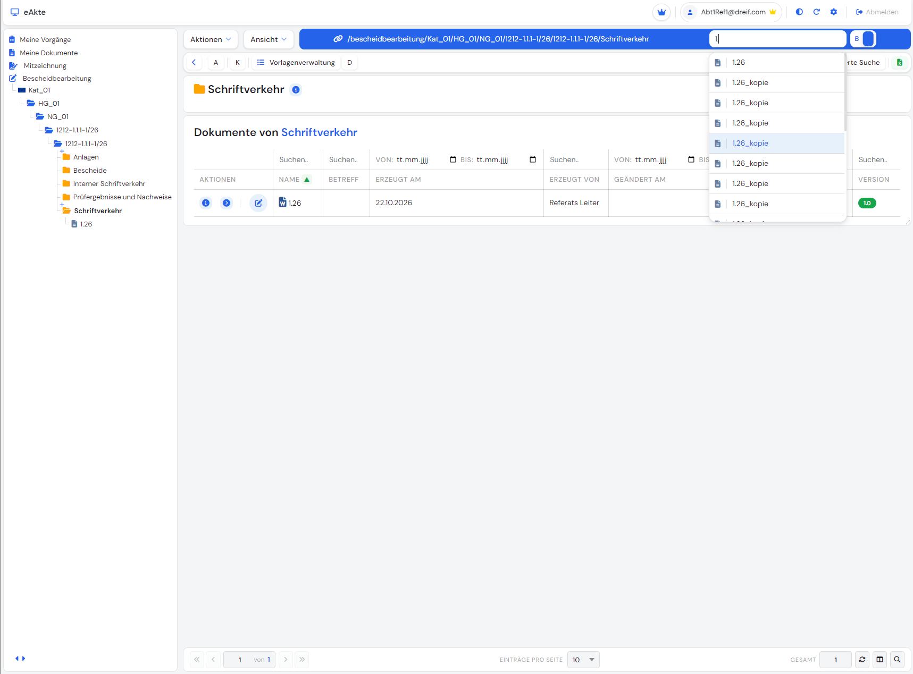
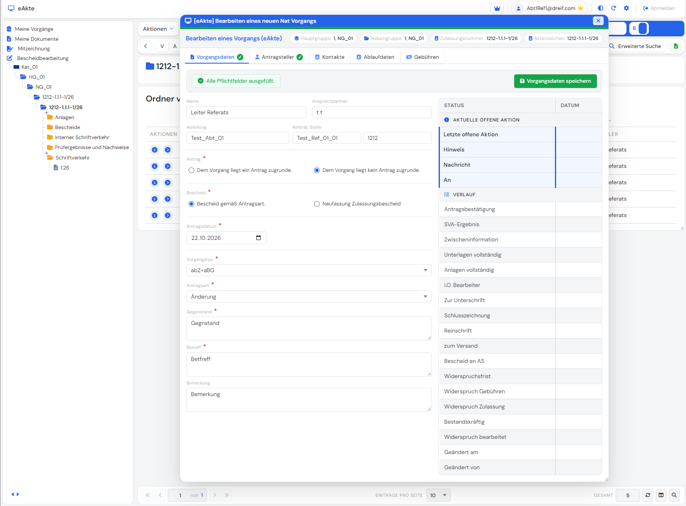

# eAkte

A multi-tenant electronic file management system (eAkte) built with **ASP.NET Core** and **SQL Server**, extended with **direct editing of Microsoft Office documents via WebDAV**. 







## Features

### Multi-tenancy (Mandant system)
- Several clients (tenants) run on one installation.
- Data of different tenants is strictly isolated; every query is scoped to the active tenant.

### Hierarchical file structure
Documents are organised in a deep, flexible hierarchy:

```
Mandant
 └── Kategorie
      └── Hauptgruppe
           └── Nebengruppe
                └── Akte
                     └── Vorgang
                          └── Ordner
                               └── Unterordner ...
                                    └── Dokument
```

- Folders can be nested to any depth.
- Documents are stored inside the matching file structure.

### Roles and permissions
- A flexible **role system** controls who can do what in the application.
- **Different permissions per function**: for example viewing, creating, editing, deleting, importing, exporting and converting documents can each be granted or denied separately.
- **Object-level access control**: access can be restricted per object, such as an Akte, Vorgang, folder or document, so users only see and work with the objects they are authorised for.
- Roles can be combined, so different users get exactly the access their job requires.
- Permissions are enforced on the server, not only hidden in the interface.
- Works together with the tenant system: users only ever see data of their own Mandant.

### Files and cases (Akten & Vorgänge)
- Create and manage **Akten** (files) within categories and groups.
- Create **Vorgänge** (cases/processes) inside an Akte to keep related work and documents together.
- Organise each Vorgang with folders and subfolders.

### Document import and export
- **Import** documents into any folder, individually or several at once.
- **Export** documents for use outside the system.
- Documents always land in the correct place in the file structure and tenant.

### Built-in PDF converter
- Convert documents to **PDF** directly inside the application.
- No external tools or manual conversion steps required.
- Useful for archiving, sharing and printing finished documents.

### Direct Office editing via WebDAV
- Open Microsoft Office documents directly from the web application.
- Edit in Word and save changes back to the system automatically.
- Replaces the earlier workflow of downloading and uploading files through a separate helper program.
- Tested with Microsoft Word 2019.

### Document locking
- **Check-out** locks a document while it is being edited.
- **Check-in** releases it when work is finished.
- Prevents several users from editing the same document at the same time.
- Lock information (who locked it, since when) is stored with the document.

### Single sign-on (planned architecture)
- Designed to integrate with a central login service using **OpenID Connect**, so that several applications (ASP.NET Core and .NET Framework 4.8) can share one sign-in.
- Generic error messages for failed sign-ins, so no internal details are exposed to the user.

## Tech stack

| Layer | Technology |
|-------|------------|
| Backend | ASP.NET Core, C# |
| Database | Microsoft SQL Server |
| Documents | WebDAV, Microsoft Office integration, PDF conversion |
| Authentication | OpenID Connect (OpenIddict) |
| Front end | HTML, CSS, JavaScript |
| IDE | Visual Studio |

## Security notes

- Secrets and connection strings are kept out of the repository.
- All data access is scoped by tenant and protected by role-based permissions.
- Documents are protected by locking during editing.

## Project background

This project was created as a software development training project: extending an existing multi-tenant electronic file management system with direct Microsoft Office editing through WebDAV.
